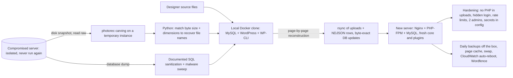

# WordPress Incident Recovery: Case Study

> Response to the July 2026 compromise of the Vale Verde Festas website: containment, root-cause analysis, a clean rebuild on a new server, about 470 broken images reconstructed in a local Docker clone, a surgical deploy, hardening, and the memory incident that followed.
> **Source code is private.** This repository documents the project; a live walkthrough is available on request.

**Stack:** WordPress with Elementor, Nginx with FastCGI page cache, PHP-FPM 8.2, MySQL 8, AWS EC2 with EBS snapshots and CloudWatch, Docker Compose and WP-CLI for the local clone, Bash and Python for the recovery scripts, photorec for file carving, Wordfence.

**Status:** incident closed in August 2026. The recovered site stays online for the company, a family events business whose technology I run; this is internal work, not a service offered to third parties.

## Problem → Solution

**Problem.** The company website was compromised in July 2026 and the damage was only noticed weeks later: unknown admin accounts, web shells on disk, about 470 images missing from the pages, and a backup routine that had been deleted along with the site. The business depends on the site for leads, and it had to come back clean, with its images, without carrying anything from the infected server.

**Solution.** Treat the old server as evidence and never run it again. Rebuild on a fresh machine from a sanitized database and freshly downloaded software, recover the lost images from a disk snapshot and from the designer's source files in a local Docker clone, push only the reconstructed data to the new site with a byte-exact deploy, then harden the stack and remove every cause in the incident chain.

## What I built

- **Root-cause analysis with evidence.** A chain of four links reconstructed from the backup and the logs: a leftover must-use plugin from a previous hosting provider had silently disabled automatic updates and replaced the health check with a green "all up to date" message; the login page had lost its protection; a file-manager plugin stayed on a version with a published critical flaw; five weeks later a rogue admin account appeared and web shells were dropped. Each link got its own fix.
- **Malware sweep and sanitized database.** Every plugin, theme, upload folder, option, and post was scanned for shells, double extensions, encoded blobs, and foreign scripts. The database was cleaned with a documented SQL script (rogue accounts, leftover options, orphaned tables) so the exact sanitization can be audited.
- **Clean rebuild scripts.** A packaging script on the Mac and a 200-line installer on the new server rebuild the whole site from scratch: fresh WordPress core and plugins, the sanitized database, the media library, and an Nginx configuration written for this site. No plugin of the old server is copied as is.
- **Image recovery in two tracks.** For images that existed only on the compromised disk, a volume was created from the snapshot and read raw with photorec, never mounted, on a temporary instance; a 160-line Python script then gave the carved files their names back by matching exact byte size and pixel dimensions recorded in the database, with signatures for 349 of 350 files. For the rest, the designer's source files were converted, compressed, and placed at the exact paths the pages referenced.
- **Local Docker clone as the workbench.** A Compose stack (MySQL, WordPress, WP-CLI) mirrored the site so every image could be reconstructed and checked page by page before anything touched the live site, with the production configuration kept in an isolated quarantine folder.
- **Surgical deploy.** Instead of restoring a whole backup over the new site, the fix was shipped as an rsync of the upload folders plus an NDJSON payload of database rows applied with byte-exact updates, with a database backup taken immediately before. 463 files and 14 Elementor pages went live in one pass.
- **Hardening.** PHP execution denied in the uploads folder, login page hidden and rate limited, form endpoints rate limited, file permissions normalized, admin accounts cut from seven to two, secrets moved out of the database into the configuration file, automatic updates re-enabled, remote backups made mandatory, Wordfence monitoring, and a double security review (two independent AI-assisted audits) before the domain was pointed.
- **Memory incident the same week.** On the day of the deploy the small instance went down twice: once when the kernel killed the database, once in a full thrash with no swap and no SSH. The fix was measured, not guessed: 2 GB of swap, PHP-FPM workers halved, a low-memory MySQL profile that took the database from about 800 MB to about 190 MB, systemd restart policies, an Nginx page cache serving hits in about 0.08 s, and a CloudWatch alarm that reboots on a failed status check.

## Architecture

## Technical challenges

- **Images referenced by ID, not by URL.** Elementor builds background CSS from the attachment ID, so fixing a URL in the page data changes nothing. Each repoint had to update the attachment record and the page data together, then drop the generated CSS so the page re-rendered. Several carousels shared the same generic file names from a staging export, so reconstructed files got unique names to avoid overwriting each other.
- **Writing page data without corrupting it.** The standard WordPress update functions strip backslashes from serialized Elementor data. All writes went through direct, byte-exact database updates, which is why the deploy used an NDJSON payload instead of a content import.
- **Recovering files that no longer had names.** File carving returns anonymous files. Matching exact byte size plus width and height against the signatures stored in the database turned out to be a strong enough key to name almost every photo automatically.
- **Not reinstalling the cause.** The hosting provider's leftover plugin looked legitimate and sat in a folder the admin panel never shows. The rebuild explicitly skips every must-use plugin, and the installer never copies the old plugin folder.
- **Choosing not to lock the file system.** The common advice of disabling all file modifications was rejected on purpose: it also blocks automatic security updates, which is exactly the failure that caused the incident. The alternative is documented in the hardening guide.
- **Honest scope for personal data.** The review assessed which personal records were exposed during the compromise window so the company could decide on its notification duties under Brazilian data protection law.

## Scale

- 97 commits in the project repository (scripts, configuration, and documentation; no site code)
- About 1,900 lines in the recovery package: installer, packaging, backup, SQL sanitization, photo re-identification, and six guides (security review, hardening, integrations, validation, photo recovery, read-me)
- 350 missing images identified by exact name, 349 with recoverable signatures
- 463 files and 14 Elementor pages republished in the surgical deploy
- Database footprint reduced from about 800 MB to about 190 MB after the memory incident
- Admin accounts reduced from 7 to 2

## My role

Sole responder, end to end: forensic analysis and root cause, malware sweep, database sanitization, the rebuild and installer scripts, the Docker clone and the image reconstruction, the photo recovery pipeline, the surgical deploy, the Nginx and PHP-FPM hardening, the memory incident diagnosis and fix, the backup routine, and the written guides the company keeps for the next operator.

---
Built by **Victor Sestrem** · [LinkedIn](https://www.linkedin.com/in/victor-sestrem/) · victor-sestrem@hotmail.com
